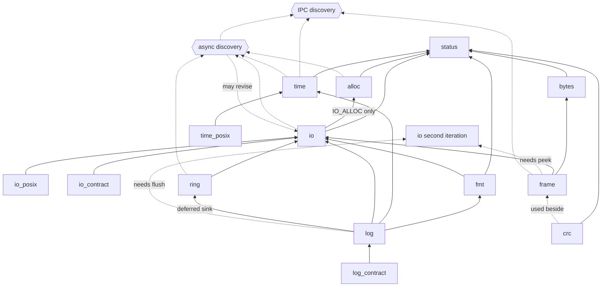

# Module plan

**The modules in this document are proposals.** Only `status` and `io`
(with `io_posix` and the io contract suite) exist; see
[build.md](build.md#what-is-verified) for what was run. Every other module
named here is unbuilt, has no header, and gets one only through
[the module process](process/new-module.md).

This plan says which modules to build after M0 and what each depends on.
It lists what was considered and rejected, and names the decisions that
have to be made before particular modules. The order, with acceptance
criteria, is in [roadmap.md](roadmap.md); milestone numbers here are the
roadmap's.

## 1. Module catalogue

Kinds: **pure** (computation on caller memory, no environment),
**interface** (a handle with backends), **backend** (one interface on one
facility), **discovery** (questions first, no header).

The admission test for every entry, from [new-module.md](process/new-module.md)
and [ADR 0001](adr/0001-scope.md): a named consumer; a reason it belongs in
Elemental rather than in the application or libc; and no option, layer, or
function without a use case.

| Module | Kind | Hard deps | Soft or informing | First consumer | Size |
|---|---|---|---|---|---|
| `fmt` | Pure core, printf over `io` buffers | `status`, `io` | — | `log` | M |
| `log` | Interface (sink), plus portable sinks | `fmt`, `time`, `io`; `ring` from M5 | drives io flush | Examples, the Zephyr UART example | M |
| `io`, second iteration | Interface revision | `status` | `log`, `frame`, async | `log` writer sink, `frame` glue | M |
| `alloc` | Interface, arena, libc backend; `io` gains the grow writer (since M3a, `el_grow_buf`) | `status` | async and IPC storage | the `io` grow writer, applications | M |
| `frame` | Pure core, plus io glue | `bytes`, `io` | `crc` used beside it | UART example, IPC discovery | M |
| Async, IPC | Discovery | — | `io`, `time`, `ring`, `frame`, `alloc` | — | L, M |
| `time` *(new)* | Interface, manual clock, POSIX backend | `status` | — | `log` | S |
| `ring` *(new)* | Pure | `io` | async discovery | `log` deferred sink | S |
| `bytes` *(new)* | Pure | `status` (assertions) | — | `frame` | S |
| `crc` *(new)* | Pure | `status` (assertions) | — | UART framing example | S |

### Named by the owner

**`fmt`: text formatting.** Integers (decimal and hex, with width and
sign), strings, and hex dumps into caller memory. A non-variadic core of
typed calls, plus a printf-subset convenience in a separate C-only header,
as [conventions.md](conventions.md#abi) allows. No floating point in the
built-in option: it pulls in soft-float helpers on small targets and has no
consumer. The core is pure conversions into a caller's scratch array.
printf formats into an `el_buf` or an `el_buffered_writer` from `io`, which
know their free space, so a number is still whole or absent; it never
writes to a bare `el_writer`. *Effects:* none. *Risk:* creep toward full
`printf`. *Decided* by the
[io buffers and fmt proposal](proposals/io-buffers-fmt.md) (M3a), which
reversed the earlier choice of its own cursor.

**`log`: logging.** A logger is a minimum level plus a sink handle. A sink
receives a record: level, timestamp, message bytes. The contract is
non-variadic ([architecture.md](architecture.md#64-logging--proposed)). The
C macros sit on top in their own header. Two sinks come first: a writer
sink, which formats a line into a stack buffer and writes it with
`el_write_all`, and a memory sink for tests. A **deferred sink** comes in
M5: it copies records into a ring and a task drains them, so an interrupt
handler can log. Elemental's own modules never log; detail stays on the
object ([conventions.md](conventions.md#errors), rule 6). *Effects:* time,
through a clock handle the caller supplies; interrupt context, in M5 only.
*Open:* the compile-time cut-off
([section 3](#3-decisions-that-must-come-first)).
*Risk:* importing every feature of `mlog` at once.

**`io`, second iteration.** The buffer (`el_buf`, `el_grow_buf`) and the
buffered writer with flush come first, in M3a, from the
[io buffers and fmt proposal](proposals/io-buffers-fmt.md); `fmt`'s printf
is their first consumer. The buffered reader comes with the frame glue
(reading until a delimiter) in M6. Flush starts as a function on the
concrete buffered type, per a provisional ADR. It becomes an operation in `el_writer_ops` only if a holder
of a bare handle must flush. In that case a null operation means "nothing
to flush" and returns `EL_OK`, so no `EL_ERR_UNSUPPORTED` is needed.
*Risk:* freezing buffer ownership before async discovery has looked at it.

**`alloc`: allocation.** As in
[architecture.md](architecture.md#62-allocation--proposed): a handle, an
arena over caller storage, a libc heap backend, and a contract suite. The
growable writer is part of `io`, behind the Kconfig symbol `IO_ALLOC`, so
that `io` depends on `alloc` only when it is on.
Pools wait for a consumer; async or IPC message storage is the likely one.
No other module in this plan takes an allocator, so allocation is a leaf.
The roadmap builds it early (M2) anyway, as the second interface and
contract suite; [roadmap.md](roadmap.md) gives the reasons. *Effects:* the
heap, in the libc backend only. *Decided:* sized free
([ADR 0012](adr/0012-sized-free.md)) and the capacity status
([ADR 0009](adr/0009-capacity-status.md)). *Risk:* without an in-tree consumer, sized free goes untested. The
proposal's three examples (a string, a growable buffer, an object handed
across an API) are therefore mandatory.

**`frame`: message framing.** Two codecs. **COBS** resynchronises after
lost bytes, for UARTs. **Length-prefix** is for reliable streams: pipes and
sockets. Each is a Sans-I/O decoder and encoder over caller buffers with a
fixed maximum message size. There is also thin glue that feeds a decoder
from an `el_reader` and keeps the would-block handling in one place
([architecture.md](architecture.md#65-async-and-ipc--discovery-before-design)).
Integrity checking is not part of the codec. The application appends a
`crc` to the payload, so `frame` makes no policy choice. *Effects:* none in
the core. *Open:* decode in place, or into a separate buffer. *Risk:* low.

**Async and IPC: discovery.** The questions are in
[architecture.md](architecture.md#65-async-and-ipc--discovery-before-design).
Discovery starts with: `time` for timeouts, `frame` for messages, and for
async also `ring` and real interrupt evidence. IPC discovery shrinks to one
question: is there a portable core beyond `frame`? The candidate is
Sans-I/O request and response correlation with deadlines passed in. A
likely answer is "framing only". *Risk:* async may revise `io`.

**Status vocabulary growth.** There will be no diagnostics module and no
richer result type of the `mresult` kind. The evidence
[ADR 0003](adr/0003-status-and-progress.md) asks for has not appeared.
Growth is codes only, each arriving with the first module that returns it:

| Code | Arrives with | Caller does |
|---|---|---|
| `EL_ERR_NO_SPACE` | the `io` buffers (full, or cannot grow); then `fmt` truncation, `ring`, `frame` encode | Provide more storage |
| `EL_ERR_INVALID_DATA` | `frame` decode | Drop the input, resynchronise |
| `EL_ERR_TIMED_OUT` | IPC correlation, if discovery keeps it | Retry or give up |

[Section 3](#3-decisions-that-must-come-first) explains why these replace
the proposed `NO_MEMORY` and `INVALID_ARGUMENT`.

### Added by this plan

**`time`: clock handle and time values.** The time representation; a clock
handle with one operation, `now`, monotonic; and pure deadline comparison.
Two implementations: a **manual clock** the caller advances, which makes
tests deterministic, and a POSIX `CLOCK_MONOTONIC` backend. No wall time,
no calendar, no sleep. *Why Elemental:* architecture §5 says time is "a
timestamp or a clock operation" given by the caller. Logging, IPC timeouts,
and the async echo-with-timeout workload all need that parameter. Without a
shared definition, each would invent its own callback and unit. ISO C has
no monotonic clock, and freestanding targets have none at all. *Open:*
unit and width ([section 3](#3-decisions-that-must-come-first)). *Risk:*
64-bit division on Cortex-M0 (`__aeabi_uldivmod`).

**`ring`: single-producer, single-consumer byte ring.** A FIFO over caller
storage. It is safe with one producer and one consumer in different
contexts, such as an interrupt handler and a task. It has reader and
writer adapters. This is the
[ring pipe example](../examples/backend_ring) promoted, with a concurrency
contract added. *Why Elemental:* the deferred log sink and an
interrupt-driven UART both need exactly this. Every firmware project writes
it again, often with a data race. It also gives Elemental's first atomic
one small, testable home. *Effects:* interrupt context and memory ordering.
*Risk:* toolchains without lock-free word-sized atomics.

**`bytes`: fixed-width byte order.** Load and store of 16-, 32-, and 64-bit
values, little and big endian, through byte pointers with no alignment
requirement. Nothing else. *Why Elemental:* ISO C has none of it. POSIX
`htonl` covers only network order up to 32 bits, and freestanding targets
have nothing. The
[status README](../modules/status/README.md#why-this-module-is-allowed-to-be-everyones-dependency)
already rejected byte order for `status`. These are real functions, not
`static inline`, because an inline-only header gives Rust and Python
nothing to link. *Risk:* being widened into a parsing cursor. Use
`el_mem_reader` until a consumer shows that a non-virtual cursor matters.

**`crc`: checksums.** CRC-32 (IEEE) and CRC-16/CCITT, incremental, as pure
functions. A Kconfig choice between a table and bitwise computation: code
size against speed, invisible to callers, so a legitimate private option.
*Why Elemental:* a framed message over a UART is useless without an
integrity check, and libc has none. Zephyr (`sys/crc.h`) and Pigweed
(`pw_checksum`) are prior art; neither was read for this plan.
Hardware CRC units are the application's optimisation, not a backend.
*Built* (M3, amended 2026-11-12): CRC-32/ISO-HDLC and CRC-16/IBM-3740, with
a private choice of 16- or 256-entry tables, GCC's CRC builtins, or
Zephyr's `sys/crc.h`, all with identical results
([proposal](proposals/bytes-crc.md#amendment-2026-11-12)).

### Deferred: a CRC engine

**A CRC-engine handle with a Zephyr-driver backend**, a separate small
interface beside `crc`, for CRC peripherals. *Deferred* (owner, 2026-11-12)
until a consumer needs hardware CRC throughput.

It cannot sit behind `el_crc*_update`. *Source facts* (Zephyr v4.5.0,
`include/zephyr/drivers/crc.h`): the driver API is bound to a device,
`crc_begin(dev, ctx)`, `crc_update(dev, ctx, buf, len)`, and
`crc_finish(dev, ctx)` over a `const struct device *` and a caller-held
`struct crc_ctx` (type, polynomial, seed, reflection flags, result); each
returns an `int` that may be a negative errno; backends exist for STM32,
NXP (two), Renesas RA, Silicon Labs, Ambiq and SiFli (`drivers/crc/`).
`subsys/crc/crc_hardware.c` wraps it as the `sys/crc.h` functions when a
devicetree `zephyr,crc` chosen node exists, logging a failure and returning
0, which is why `CRC_ZEPHYR` refuses that configuration. So the interface
needs a handle (the device), a status on every call, and a statement of
execution context, none of which `crc` has. `el_crc32_update` and
`el_crc16_ibm3740_update` are its test oracles.

### Considered and rejected

| Idea | Why not now | Revisit if |
|---|---|---|
| Locks, mutexes, a `sync` module | No module needs one. Thread safety stays the caller's ([conventions.md](conventions.md#concurrency-and-execution-context)). A logger shared by threads gets the application's lock or one logger per thread. | A module cannot meet its contract without one |
| Atomics as a module | One user (`ring`). The rules are a decision, not an API. | A second module needs read-modify-write |
| Threads, an executor, an event loop | The application owns them ([architecture.md](architecture.md#1-project-boundaries)) | Async discovery says otherwise |
| Software timers, timer wheels | An executor concern. No consumer before async. | Async discovery output |
| Random source | No consumer. Request IDs are counters. A hardware RNG or `getrandom` is already expressible as an `el_reader`. Cryptographic quality is external-library territory. | A module needs randomness |
| Files, directories, storage, key-value | An open descriptor is already an `io_posix` stream. Open, seek, and naming have no consumer. Flash filesystems are external libraries. | A consumer needs seek |
| Sockets, networking | A connected socket is an `io_posix` stream. Setup is transport-specific (IPC table). | IPC discovery |
| A slice or string type | (pointer, length) parameters already work. A by-value non-handle struct breaks ABI rule 8 ([conventions.md](conventions.md#abi)). String helpers were rejected for `status`, and nothing needs them elsewhere. | Several modules pass the same pair awkwardly |
| Text parsing (`strtol` replacements) | No consumer. Bare `el_parse` is also a libedit symbol. | A shell or configuration example needs it |
| Containers: lists, maps, pools | No consumer outside discovery. Pools belong in `alloc`. | Async discovery asks for an intrusive queue |
| Diagnostics or rich error values (`mresult`) | Per [ADR 0003](adr/0003-status-and-progress.md), detail lives on the object, and no counter-example exists | Its revisit condition is met |
| Runtime shim (`memcpy` and friends) | [ADR 0001](adr/0001-scope.md) | Ports carry identical shims |
| A `contract` support module for the suites' check, skip, and report machinery | GoogleTest provides it ([ADR 0008](adr/0008-googletest.md)) | Suites must run where GoogleTest cannot |
| Tokenised or binary logging | A domain of its own; an external-library candidate | Log size on a device is measured as a problem |
| A UART module or board backends in `modules/` | Board-specific. Belongs to a platform port. | — |
| Wall-clock time, calendars, time zones | Not needed for timeouts or log ordering | A sink must print dates |

The UART used in M5 is an **example**, under `examples/` or
`tests/zephyr/`, like the ring pipe. It is not a shipped backend.

## 2. Dependency graph

Solid arrows are build and link dependencies, from a module to what it
depends on. Dotted arrows run from a module to the design it informs, and
create no link.

| Module | Hard dependencies | Informs, or is informed by |
|---|---|---|
| `status` | — | — |
| `io` | `status`; `alloc` when `IO_ALLOC` is on | revised by async discovery |
| `io_contract` | `io` | — |
| `bytes` | `status` | — |
| `crc` | `status` | used beside `frame` |
| `fmt` | `status`, `io` | — |
| `time`, `time_posix` | `status`; `time` | — |
| `ring` | `io` | async discovery |
| `log`, `log_contract` | `fmt`, `time`, `io`, `ring`; `log` | drives io flush |
| `frame` | `bytes`, `io` | drives io peek; IPC discovery |
| `alloc` | `status` | async and IPC storage |
| IPC discovery | — | `frame`, `time`, async findings |
| async discovery | — | `io`, `time`, `ring`, `alloc` |

Longest chain: `log_contract` → `log` → `ring` → `io` → `status`.

**No cycles.** The apparent ones, and how they are broken:

- *Logging needs formatting, formatting writes to a writer, and a writer
  backend wants to log.* `fmt` writes into an io buffer; `io` does not
  depend on `fmt`.
  Backends never log; they keep detail on the object
  ([conventions.md](conventions.md#errors), rule 6).
- *Allocation creeping into io.* The growable writer is part of `io`,
  behind `IO_ALLOC`. The check is that `elemental::io` links without
  `elemental::alloc` when `IO_ALLOC` is off.
- *Contract suites reporting through logging.* They are GoogleTest suites
  and report through it, as `io_contract` does. Contract suites also depend
  on GoogleTest, which is a test-only dependency and outside this graph.
- *The assertion handler wants to log.* The application wires that in its
  own `el_assert_failed`. Elemental never calls `log` internally.
- *io informs async, and async may revise io.* These are design edges, not
  build edges. They are why io stays experimental until async discovery
  reports.

## 3. Decisions that must come first

Each decision is listed with the module it blocks and the recommended
answer. Each becomes a short ADR when it is made.

**Capacity and bad-input statuses. Before `alloc`.** *Decided in
[ADR 0009](adr/0009-capacity-status.md).* One code,
`EL_ERR_NO_SPACE`, means "the storage available was not enough". It covers
a full format buffer, a full ring, a frame larger than its buffer, and an
exhausted allocator inside a function that allocates. In every case the
caller's response is the same: supply more. This replaces the planned
`EL_ERR_NO_MEMORY`. It stays distinct from `EL_ERR_END_OF_STREAM`, which is
permanent. Malformed input gets `EL_ERR_INVALID_DATA`. The
`INVALID_ARGUMENT` name listed in the status README invites returning a
status for what [conventions.md](conventions.md#arguments) says is an
assertion.

**Where stream glue lives. Before `fmt` and `frame`.** Core logic takes
bytes in and gives results out. A module adds `io` as a dependency only for
glue that holds real logic. `frame` qualifies, because resynchronising
across would-block is logic. `fmt` depends on `io` after all (owner,
2026-11-13): its output targets are io buffers, and that glue holds real
logic, fitting items and making room by flushing.

**Time representation. Before the log record.** Recommended: a monotonic
`uint64_t` tick count, with the frequency stated by the clock instance. Add
and compare in ticks. Convert to and from seconds only in explicit helpers,
so the 64-bit division is visible and stays out of hot paths. Deadlines are
values compared by the caller. No module reads a clock it was not handed.

**The compile-time log level. Before `log`.** Recommended: the cut-off is a
macro the consumer defines per target or per translation unit, like
`NDEBUG`. It defaults to keeping everything. The library has runtime levels
per logger and no compile-time level at all. With no configured value in
the library, caller and library cannot disagree, so no link-time guard is
needed. This is simpler than making a mismatch between caller and library
a build or link error. It is still an exception to ADR 0004 (a public macro whose
expansion varies), and it is recorded as one. Kconfig does not set it.

**Atomics and interrupt context. Before `ring` and any sink is used from an
interrupt.** Recommended: Elemental uses C11 `<stdatomic.h>` only for
acquire loads and release stores of lock-free word-sized values. It uses no
read-modify-write and no locks. Static assertions check that the values are
lock-free. That is enough for single-producer, single-consumer rings. It
compiles to plain loads, stores, and barriers on ARMv6-M, and it needs no
`libatomic`. A module that needs more takes a critical-section operation
from its caller. It does not use a global one. "ISR-safe" keeps the meaning
in [conventions.md](conventions.md#concurrency-and-execution-context).

**Sized free. Before anything stores an allocator.** *Decided in
[ADR 0012](adr/0012-sized-free.md)*, by the allocation proposal's examples:
`el_free` takes the size and alignment back, as one `el_layout`
([ADR 0013](adr/0013-allocation-layout.md)).

**Optional operations. Before an operation table grows.** A null optional
operation has a defined, harmless meaning, such as "nothing to flush", where
one exists. `EL_ERR_UNSUPPORTED` is admitted only when no such meaning
exists.

**New `el_` names. Before each header freezes.** Function names are
`el_<module>_<verb>`. Any bare `el_<verb>` (`el_alloc`, `el_free`) is
checked against the names `histedit.h` declares, because libedit shares
the `el_` prefix ([ADR 0006](adr/0006-c11-and-naming.md)).

## 4. Risks, and what would change the plan

| Risk | Effect | Mitigation |
|---|---|---|
| A toolchain in range has no lock-free word atomics, or no `<stdatomic.h>` | `ring`, and so the deferred sink, are unavailable there | Kconfig makes `ring` depend on a probed atomics symbol, so the failure happens at configuration time |
| 64-bit time arithmetic pulls compiler helpers onto Cortex-M0 | A new symbol in the allowlist | The Zephyr symbol check on `qemu_cortex_m0` (M1) catches it; conversion stays in explicit helpers |
| `log` and `fmt` grow to match `mlog` or `printf` | Size on small targets; a slow M4 | Each feature names a consumer, as everywhere else |
| Async discovery shows that `io` needs a different buffer model | io changes after M7 | io is not promoted before M9. This is why M10 follows M9. |
| Four small modules raise the maintenance surface | More to verify per toolchain | Three are pure and tested by vectors; `time` is one small interface |
| GoogleTest does not fit the Zephyr targets that matter | No on-target test evidence for any module | Found out in M1: it fits a Cortex-M3 board with about 272 KB flash and 40 KB RAM, not `qemu_cortex_m0`. ADR 0008 names the fallbacks |
| An emulator run is mistaken for interrupt evidence | Overclaiming | M5's last acceptance item; hardware stays an M1 item |

What would change the order:

- **Discovery finds no use for an allocator.** `alloc` stays experimental:
  [promotion](process/api-stability.md#promotion-to-stable) needs two
  consumers not written to demonstrate it.
- **Async discovery concludes "not in scope".** M10 shrinks to io promotion
  and IPC.
- **IPC discovery finds nothing beyond framing.** No IPC module; `frame` is
  the answer.
- **The atomics decision fails on a target that matters.** M5 needs a
  caller-supplied critical section from the start. That makes the deferred
  sink's contract heavier, and it should be re-proposed.
- **Integrity must be inside the codec**, for example because every
  transport in use is lossy. Then `crc` becomes a hard dependency of
  `frame`.
- **Elemental's Kconfig is sourced into another Kconfig tree**, such as
  Zephyr's, which already has `LOG` and `ASSERT`. Unprefixed module symbols
  would collide there. Today Elemental runs its own Kconfig tree, so this
  does not arise.
